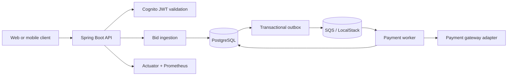

# Architecture overview

## Integrity boundaries

- PostgreSQL is authoritative for persisted bid ordering, bid history, orders,
  payment attempts, and outbox delivery state.
- Bid ingestion uses a compare-and-set update so concurrent requests cannot
  overwrite a newer bid. The accepted bid and its history row commit together.
- Settlement creates the order and its payment event in one transaction. The
  outbox makes event publication recoverable after a process restart.
- SQS is deliberately treated as at-least-once delivery. The payment worker
  uses durable idempotency claims before calling the gateway.
- Payment methods store provider-issued instrument references only. Raw card
  data remains outside this service.

See the ADRs in [`adr/`](adr/) for the key design decisions.
